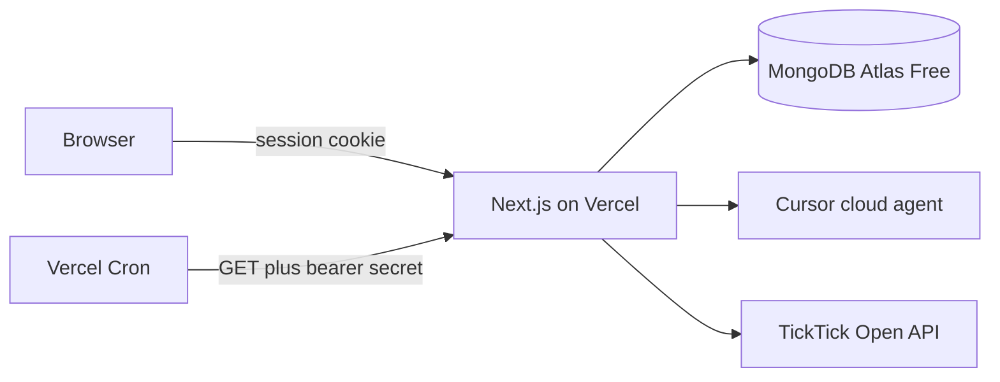
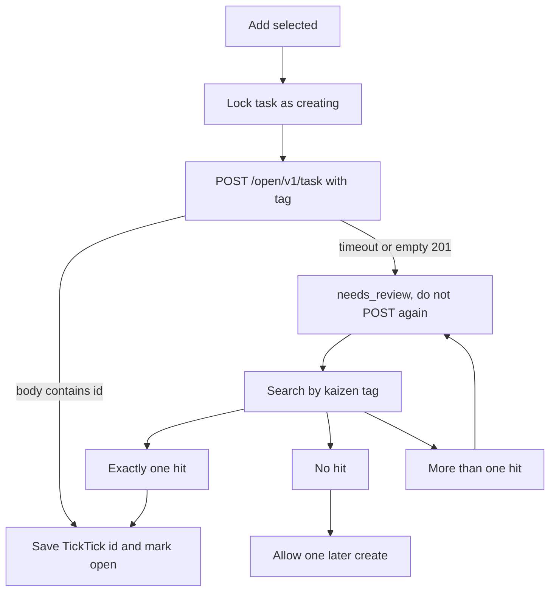
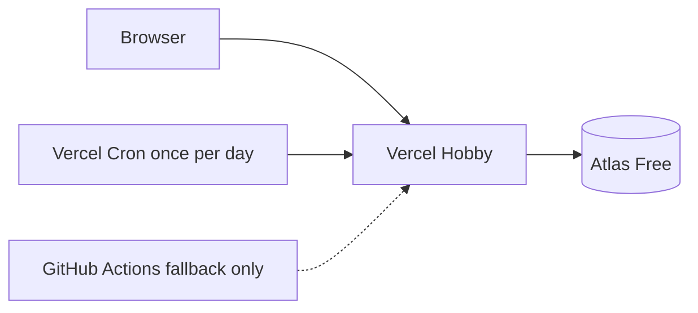
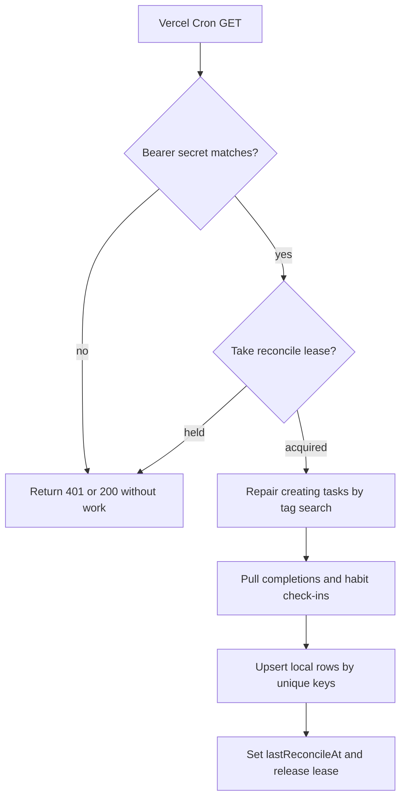

# Kaizen brain-dump app: research and architecture

Research date: **13 October 2026**. This is a technical decision report for a single-user personal app. It is not an implementation.

## 1. Executive Summary

Build one **Next.js (App Router) TypeScript** application. Keep the Cursor API key, TickTick token, and MongoDB behind server-only modules. Host it on **Vercel Hobby**. Store data in **MongoDB Atlas Free**. Run nightly reconciliation with **Vercel Cron**, which calls the production app over HTTPS even when the browser is closed.

| Decision | Recommendation |
| --- | --- |
| Architecture | One Next.js modular monolith. No separate Express or .NET service. |
| Database | MongoDB Atlas Free. Six collections. |
| AI | Cursor SDK, one-shot cloud agent with no repository, model `composer-2.5`. The app validates JSON and renders Markdown. Requires Pro or above. The India Start plan does not include the SDK. |
| Manual capture | Bullet lines become tasks, habits, or evaluation notes with no model call. TickTick is still only updated after **Add selected**. |
| Google AI Pro / Gemini | Not the organizer. Gemini remains a documented fallback if this Cursor account cannot create a no-repo cloud agent. |
| Tasks | Created in TickTick only after the user clicks **Add selected**. |
| Habits | TickTick Habit check-ins, mirrored in MongoDB. Not repeating tasks. |
| Nightly sync | `GET /api/cron/reconcile`, protected by `CRON_SECRET`. |
| UI | Three places: Today, Journal, Insights. Settings is a gear, not a tab. |
| Editor | Plain textarea. |
| ₹0/month | **Yes for hosting and the database.** Organize spends the Cursor plan's included usage pool. It is not a separate Gemini bill. Extra Cursor usage is pay-as-you-go only after that pool is exhausted. |

Rejected alternatives: a Vite SPA plus Express, and ASP.NET Core. Both add a second runtime without giving this app a scheduler, a database, or an API that Next.js lacks.

The first code to write is login, the database connection, and a daily dump that survives refresh. Before any TickTick or habit code, run the personal-access-token tests in section 17 against a disposable TickTick list.

## 2. Product Goals and User Workflow

The product removes the need to organize a thought before it is written down. TickTick remains the phone list. This app is the place to unload, approve, and look back. It is not a second task manager.

Goals:

- Write or paste a messy note with no title, tag, or questionnaire.
- Keep that exact text even when AI or the network fails.
- Turn it into a short summary, a readable note, and a few real commitments.
- Create TickTick tasks only for lines the user accepts.
- Record habits as days practiced. A gap changes nothing that was already recorded.
- Show the week and month as counts and a calm grid, not a score.

**Today** is the only daily screen. The editor is focused on load.

Immediate path:

1. Open the app. Today's text is restored if it exists.
2. Write raw prose, or write bullet lines. The dump autosaves either way.
3. Leave whenever. Skipping both buttons creates nothing in TickTick.
4. Use one of the two organize actions below. Both show the same review list.
5. Edit, uncheck, or confirm dates. Explicit items start checked.
6. Click **Add selected**. Tasks are created locally and pushed to TickTick. Habit lines create or check in a habit. Evaluation lines stay in the journal and feed Insights. They are not sent to TickTick.
7. Mark any remaining habits on the same screen.

**From bullets, no model.** A line is recognized only when it uses the prefix. Anything else stays prose.

| Line | Becomes | Leaves the app |
| --- | --- | --- |
| `- task: Call the dentist` | Task proposal for today | TickTick, after **Add selected** |
| `- habit: Exercise` | Habit proposal. If that habit already exists, it is today's check-in | TickTick Habit check-in when the token allows it. Otherwise local only |
| `- eval: Finished the resume draft` | Evaluation note for today | Insights only. Never TickTick |

`- [ ] Call the dentist` is treated as `- task:`. A bullet with no prefix is not a task, so a messy dump cannot accidentally push every line.

**From AI.** **Organize** saves the dump, then the server calls the Cursor API once. The same three buckets come back: tasks, habits, evaluation notes. The user still has to press **Add selected**. AI output and bullet output share one `proposalKey` rule, so organizing twice does not create a second TickTick task.

Optional, and never required to finish the day: edit the raw text and organize again, dismiss a habit suggestion, move open tasks to tomorrow, set a task aside, add a one-line closing note, or open Journal or Insights. If tasks are still open, Today may say "2 still open. Move them to tomorrow?" Ignoring that is a valid end.

Reprocessing the same day must not offer or create a task that was already added. A line that disappeared from the dump is labeled "No longer in the dump" and stays until the user sets it aside.

## 3. Functional Requirements

MVP means the first usable version. Later means a real improvement that should not block daily use.

### Brain dump

| Requirement | Release |
| --- | --- |
| One dump per local calendar day, restored on load, editable all day | MVP |
| Autosave, plus a local buffer so refresh or a failed save does not drop text | MVP |
| Save without calling AI | MVP |
| Bullet lines `task:`, `habit:`, and `eval:` parsed on the server with no model call | MVP |
| Raw text kept until the user explicitly deletes that day | MVP |
| States: saving, saved, organizing, could not organize | MVP |
| After Organize, the raw text collapses; the proposal is what you read | MVP |
| Keyboard shortcut for Organize; usable on a phone with the keyboard open | MVP |
| Several dumps in one day, voice, images, full-text search | Later |

### AI review

| Requirement | Release |
| --- | --- |
| Organize on demand only, through the Cursor SDK | MVP |
| The same review list accepts bullet proposals and AI proposals | MVP |
| Summary, journal text rendered by the app, tasks, non-actionable thoughts, habit suggestions, uncertainties | MVP |
| No invented tasks, dates, or facts. Ambiguous dates stay empty until the user confirms them | MVP |
| Explicit commitments and suggestions look different | MVP |
| Edit the proposal before anything is added | MVP |
| A failed or invalid model response leaves the raw dump and creates no task | MVP |
| Reprocessing cannot create a second TickTick task for an item already added | MVP |
| Tags as a reporting feature, follow-up chips, AI-written insight paragraphs | Later |

### Tasks

| Requirement | Release |
| --- | --- |
| A task row is inserted only by **Add selected** | MVP |
| Stable id, title, optional description, source dump, planned date, optional due date, priority only when stated, status, TickTick ids, sync status, timestamps | MVP |
| Planned date defaults to today. A due date is stored only after a real deadline is confirmed | MVP |
| Statuses: `approved`, `open`, `completed`, `cancelled` | MVP |
| Move to tomorrow changes `plannedDate` and records `postponedFromDate`. The status stays `open` | MVP |
| Set aside sets `cancelled`. It leaves the day and every completion count | MVP |
| One TickTick list, chosen in Settings | MVP |
| Complete in this app or in TickTick, once sync has run | MVP |
| Retry uses the same internal id and cannot create a second remote task | MVP |
| Deleting a dump does not delete tasks already added | MVP |
| Reopen in this app | Only after the token test in section 7 proves it |
| Per-task lists, subtasks, reminders, a full backlog screen | Later. TickTick is the backlog |

### Habits

| Requirement | Release |
| --- | --- |
| Create from a suggestion or a short sheet: name, daily or specific weekdays | MVP |
| Active or archived. Archive hides it from Today and keeps history | MVP |
| One completion per habit per local date | MVP |
| A missed day stores nothing | MVP |
| Today's due habits are checkboxes on Today | MVP |
| Completion is a TickTick habit check-in when the token can call the Habit API, mirrored in MongoDB | MVP, after the token test |
| If the token cannot call habits, check-ins stay in this app and nothing is created in TickTick | MVP fallback |
| Reminder times, quantity targets, notes per day | Later |
| One generated task per day, or a repeating TickTick task as the history record | Do not build |

### Reports and tone

| Requirement | Release |
| --- | --- |
| Today shows counts: done, still open, moved | MVP |
| Insights has Week (default) and Month: days with a dump, tasks done, tasks moved, tasks set aside, habits practiced | MVP |
| Habit grid: practiced days filled, other days empty | MVP |
| A productivity score, a streak, a red overdue total, push notifications | Do not build |
| Charts and category breakdowns | Later |

Copy stays factual: "Saved." "Could not organize this. Your dump is saved." "Nothing to add." "2 still open." "A quiet day." Unfinished work is "still open" or "moved to tomorrow."

## 4. Recommended Architecture

Use one Next.js application. Domain code lives in `server/` and is imported only by Route Handlers and Server Components. Client components never import `server/`.

| Module | Responsibility | Where it runs |
| --- | --- | --- |
| `auth` | Check the password, set and clear the session cookie, reject anonymous calls, verify the cron secret | Server. The client only shows a login form |
| `braindumps` | Autosave and load the one dump for a local day. Raw text is written before any model call | Server writes MongoDB. Client is the editor and draft buffer |
| `ai` | Call the Cursor SDK once, validate JSON with Zod, render Markdown. No TickTick writes. Bullet parsing lives here too and does not call Cursor | Server only |
| `tasks` | Approve, edit, complete, move, set aside. Approval is the only gate into TickTick | Server owns records. Client is the review list on Today |
| `habits` | Definitions, archive, schedule, one completion per local date | Server owns history. Client is the checkbox row on Today |
| `sync` | TickTick client, idempotency, retries, pull, nightly reconcile | Server only |
| `reports` | Counts for Today and Insights, computed when those screens open | Server query. The cron job does not build reports |
| `db` | One cached `MongoClient`, collections, indexes. Node.js runtime, not Edge | Server only |

The client may edit, autosave, and show sync errors. It must not hold `CURSOR_API_KEY`, the TickTick token, `MONGODB_URI`, `SESSION_SECRET`, or `CRON_SECRET`, and it must not call Cursor or TickTick.



Scheduled work is an HTTP GET from Vercel Cron to the production deployment. There is no worker process inside the app. GitHub Actions can call the same route later if a second run per day becomes necessary. Do not run both schedulers at once.

Suggested layout:

```text
app/
  (app)/today/
  (app)/journal/
  (app)/insights/
  (app)/settings/
  login/
  api/auth/
  api/braindumps/
  api/tasks/
  api/habits/
  api/reports/
  api/sync/
  api/cron/reconcile/
components/
server/auth|braindumps|ai|tasks|habits|sync|reports|db/
shared/schemas/
```

`shared/schemas` holds Zod objects with no secrets and no I/O. Every file under `server/` imports `server-only`.

High-level routes:

- `POST /api/auth/login`, `POST /api/auth/logout`, `GET /api/auth/session`
- `GET` and `PUT /api/braindumps/today` — the single dump for the user's local date
- `POST /api/braindumps/today/process` — Cursor Organize only
- `POST /api/braindumps/today/bullets` — parse `task:`, `habit:`, and `eval:` lines, no model call
- `POST /api/tasks` — body is the accepted proposal keys; this is **Add selected**
- `PATCH /api/tasks/:id` — edit, complete, move, set aside
- `POST /api/sync/pull` — session; used when Today loads and by a Sync button
- `GET` and `POST /api/habits`, `POST /api/habits/:id/checkin`
- `GET /api/reports/summary?range=week|month`
- `GET /api/cron/reconcile` — bearer secret only, no session
- `GET` and `PATCH /api/settings` — time zone and TickTick list id only

There is no Tasks page and no Habits page in the navigation. Those modules still exist as API and server code.

## 5. React + Node.js vs. Next.js vs. .NET Comparison

| Criterion | Vite + Express | Next.js | ASP.NET Core |
| --- | --- | --- | --- |
| Speed to a usable editor | Two processes, CORS, and a shared-types package before the page works | One TypeScript project and one dev server | Slowest. Razor is one process but a weaker writing app. React plus a .NET API is two codebases |
| Deployables | Two, unless Express also serves the SPA | One | One only with Razor or Docker. Render has no native .NET runtime |
| MongoDB | Official Node driver | Same driver. Cache the client across invocations. Node.js runtime required | Official .NET driver is excellent and does not change the decision |
| Gemini and TickTick | Server `fetch` | Same, plus `server-only` so a client import fails the build | `HttpClient`. No advantage for two JSON APIs |
| Nightly job without a resident process | Render Free sleeps after 15 idle minutes and cannot cron itself. Render cron has no free plan | Vercel Cron sends the HTTP GET. The function starts for that request | Same sleep problem on a free container, and Vercel Hobby is not an ASP.NET host |
| Types | Shared types drift across two packages | One language. Zod is shared by forms, routes, and the model contract | Stronger server types, with a second language for the editor |
| Secrets | Possible, with a second public origin to lock down | Non-`NEXT_PUBLIC_` variables stay on the server. One origin, so the cookie is simple | Sound, with more deployment surface |
| Free personal hosting | Render Free can run Node, then sleeps for about a minute on the next request | Hobby is for non-commercial personal projects and includes daily cron | Docker on Render Free still sleeps and still needs an external scheduler |
| Cold start of the editor | About one minute after Render spins a free service down | The first request of the day starts a function. Vercel does not document a one-minute spin-down | Render container start plus the one-minute wake |

Sources for the limits are in section 20. A separate Express process has nothing to own: Gemini and TickTick are short HTTP calls from a request the user already made, plus one nightly HTTP call. .NET would be the better server if the work were CPU-heavy, needed a long-lived worker, or the maintainer already worked in C#. None of those are true here.

NestJS is unnecessary. Route Handlers are enough.

## 6. Gemini API and Google AI Pro Feasibility

The organizer for this app is the **Cursor SDK**, not Gemini. This section keeps the Gemini findings so the fallback stays documented, then states how Organize actually runs.

### Chosen organizer: Cursor API

Checked 13 October 2026 on the [TypeScript SDK](https://cursor.com/docs/sdk/typescript) and [models and pricing](https://cursor.com/docs/models-and-pricing).

Organize is one cloud agent call with an empty repository list:

```ts
const result = await Agent.prompt(prompt, {
  apiKey: process.env.CURSOR_API_KEY!,
  model: { id: "composer-2.5" },
  cloud: { repos: [] },
});
```

The prompt asks for the same JSON contract in section 10 and says to invent nothing. The server parses `result.result` with Zod. A failed parse leaves the raw dump and creates no task. The key stays on the server.

Why this shape:

- SDK runs bill against the same pools as the IDE. On Pro, Pro Plus, and Ultra, included usage shows `chargedCents` of 0 until the pool is exhausted. After that, usage is pay-as-you-go.
- The India **Start** plan (₹649/month) does not include the SDK. Organize will not work on Start. Bullet capture still will.
- A Vercel function cannot host the local agent runtime. Local mode needs Node 22.13+, a working directory, and a sandbox helper, and by default it may run tools. The deployed app uses a **no-repo cloud agent** (`cloud: { repos: [] }`). Cursor documents that no-repo agents must be enabled on the account, and a repository-scoped key cannot create them. Use a user API key from [Cursor Dashboard → Integrations](https://cursor.com/dashboard/integrations).
- `composer-2.5` is the current default coding model and sits in the Cursor Models pool. Do not send the dump to a third-party model id unless that pool is intentionally selected.
- Privacy Mode for the SDK follows the same rules as IDE and Cloud Agent runs. The journal text is still sent to Cursor's cloud VM for that one call. This is not a local-only parse.
- The SDK does not offer Gemini-style schema enforcement. Zod on the server is the guard. `sourceText` must still appear in the saved dump.
- One Organize click is one agent run. It uses the same allowance as coding in Cursor. Bullet capture does not.

If no-repo agents are disabled on the account, Organize shows "Could not organize this. Your dump is saved." and the bullet path remains.

### What the subscription actually covers

Google AI Pro and the Gemini Developer API are different products.

| Surface | What it is | Does Pro pay for it? |
| --- | --- | --- |
| gemini.google.com and Gemini inside Google apps | Consumer product | Yes, that is what the subscription is for |
| Google AI Studio playground and Build | Developer UI | Pro raises quotas **inside that UI** |
| Gemini Developer API (`generativelanguage.googleapis.com`) | The API this app must call | **No.** Official docs: plan benefits apply only inside the AI Studio web interface. Direct API use is billed separately |

Checked 13 October 2026 on [Google AI plans](https://ai.google.dev/gemini-api/docs/google-ai-plans) (page updated 2026-08-18 UTC).

The same page says subscribers with Cloud Billing enabled may receive monthly Google Cloud credits through the Google Developer Program, including for the Gemini API. On Prepay, a paid balance above $0 is required before those credits are consumed, and eligible credits are applied first. Google One AI credits do not apply. The "$10 per month" amount appears on the US plan catalog and in Google's 27 January 2026 Developer Program post. This research did not open a separate India catalog page, so treat **$10 as US-documented**, not as a confirmed India entitlement.

### Model and tier

Use **`gemini-3.5-flash-lite`** on the **paid** tier, standard pricing, `thinking_level: "minimal"`, no Search or Maps grounding, JSON schema mode.

Why this model: official use cases include document extraction and structured JSON; structured outputs are supported; the context window is 1,048,576 input tokens and 65,536 output tokens; the default thinking level is `minimal`, which Google says to leave on for high-volume extraction. Standard paid price, checked on the pricing page on 13 October 2026: **$0.30 / 1M input** and **$2.50 / 1M output**, and the output price includes thinking tokens. Free-tier cells for this model say "Free of charge" and "Used to improve our products: Yes." Paid says "No."

Cheaper documented alternative: `gemini-3.1-flash-lite` at **$0.25 / 1M input** and **$1.50 / 1M output** for text. Try it only if 3.5 Flash-Lite is more accurate than this writing needs. Do not start on `gemini-3.8-flash`: `minimal` thinking is rejected there, and the price is higher.

Do not send `temperature`. On 3.5 Flash-Lite and later, `temperature`, `top_p`, and `top_k` are ignored and may later return HTTP 400.

### Why the free tier is the wrong place for this data

The Gemini API Additional Terms, effective 23 March 2026 and last updated 2026-04-28 UTC, say unpaid services include unpaid API quota. Google may use those prompts and responses to improve products. Human reviewers may read them after the text is disconnected from the account. The terms say not to submit sensitive, confidential, or personal information to unpaid services. Paid API use, which requires a Cloud project with an active billing account, is not used to improve products. Google still logs paid prompts and responses for a limited period for abuse monitoring. The abuse-monitoring page states **55 days**. There is no documented region pin for the Developer API. Paid data may be stored in any country where Google or its agents operate.

The EEA, Switzerland, and UK exception (unpaid use still follows paid data terms) does not apply in India.

A brain dump is personal data. Use the paid tier. Do not enable grounding. Do not share logs or datasets. Use `generateContent` for this one-shot call. Vertex AI zero-retention is a different product and was not priced.

### Billing mechanics that affect cost

Checked on [Gemini API billing](https://ai.google.dev/gemini-api/docs/billing) on 13 October 2026:

- New accounts start on the free tier.
- Moving to paid means linking Cloud Billing. New users are asked to prepay a **minimum of $5**.
- When the Prepay balance hits **$0**, API keys stop and requests return **HTTP 402**. The project is not downgraded to the free tier. Do not retry 402.
- Unused prepaid credits expire after 12 months and are non-refundable, except when switching that account to Postpay.
- Prepaid credits must exist before eligible Cloud credits are consumed. At a $0 balance, Cloud credits stop being consumed.
- Turn **auto-reload off**. If it is ever enabled, set the monthly auto-charge limit. Also set a small project spend cap. Billing can lag about 10 minutes, so a burst can go slightly negative.
- Free-quota exhaustion does not silently start billing. Over-limit requests return **429**.
- Public rate-limit docs do not publish RPM, TPM, or RPD. They publish spend windows (Free N/A, Tier 1 $10 per 10 minutes) and tell you to read the live quota in AI Studio. One request a day will not approach those spend windows. Exact free-tier request quotas remain unpublished.
- HTTP 400 and 500 are not token-billed but still count toward quota. Do not retry 400, 402, or 403. Retry 429, 408, and 5xx with backoff.

### Privacy controls in the app

- The API key lives only in the server environment.
- Logs may include the dump id, HTTP status, and token counts. They must not include raw text, the validated result, or the key.
- Store usage integers when the API returns them. If it omits usage, store null rather than zero.

## 7. TickTick API Capabilities and Limitations

Base URL in official examples: `https://api.ticktick.com/open/v1`.

The OpenAPI markdown at `https://developer.ticktick.com/docs/openapi.md` returned **HTTP 500** when rechecked on 13 October 2026. The capability table below combines that document, as read earlier the same day, with the official TickTick CLI (`@ticktick/ticktick-cli` 0.1.14, repository `TickTeam/ticktick-cli`, updated 22 September 2026), which publishes the path each command calls. The developer portal is [developer.ticktick.com](https://developer.ticktick.com/docs#/openapi). Anything marked "confirm with the token" must be exercised before implementation. Do not call the private client API at `api.ticktick.com/api/v2`.

Authentication: a personal access token is sent as `Authorization: Bearer <token>`. The CLI documents creating it at Settings → Account → API Token. OAuth scopes in the OpenAPI text are `tasks:read` and `tasks:write` only. The Habit endpoints are in the same API surface, but those scopes do not name habits. Whether this token can call habits is unverified.

| Capability | Supported? | Method and path | Confidence |
| --- | --- | --- | --- |
| List projects | Yes | `GET /open/v1/project` | High |
| Get project | Yes | `GET /open/v1/project/{projectId}` | High |
| Project with tasks | Yes | `GET /open/v1/project/{projectId}/data` | High that the route exists. The OpenAPI text described `tasks` as undone tasks. The CLI only says "project with tasks." Confirm before treating absence as completion or deletion |
| Create task | Yes | `POST /open/v1/task` | High. Required: `title`, `projectId`. Optional includes `content`, `desc`, dates, `timeZone`, `priority`, `tags`, `repeatFlag` |
| Update task | Yes | `POST /open/v1/task/{taskId}` | High. CLI documents `status` on update: `-1` abandoned, `0` open, `2` completed. It also says `completedTime` cannot be cleared |
| Complete task | Yes | `POST /open/v1/project/{projectId}/task/{taskId}/complete` | High. Empty success body |
| Complete up to 50 | Yes | `POST /open/v1/task/completeTasks` | High |
| Delete task | Yes | `DELETE /open/v1/project/{projectId}/task/{taskId}` | High. No restore route was found |
| Get one task | Yes | `GET /open/v1/project/{projectId}/task/{taskId}` | High |
| Move across lists | Yes | `POST /open/v1/task/move` | High |
| List completed | Yes | `POST /open/v1/task/completed` | High. OpenAPI text: at most 200, filtered by `completedTime` |
| Search | Yes | `POST /open/v1/task/search` | High. Supports `tags` and `status` |
| Filter and undone windows | Yes | `POST /open/v1/task/filter`, `POST /open/v1/task/undone` | High that the routes exist. OpenAPI text: undone range longer than 14 days returns `[]`. Confirm with the token |
| Priority values | Yes | `0` none, `1` low, `3` medium, `5` high | High |
| Dates | Yes | `yyyy-MM-dd'T'HH:mm:ssZ`, example `2019-11-13T03:00:00+0000` | High. Send `+0000`, not `Z` |
| Recurrence on a task | Yes, as one series | `repeatFlag` such as `RRULE:FREQ=DAILY;INTERVAL=1`, plus `repeatFrom` 0, 1, or 2 | High that the fields exist. No occurrence id was found |
| Dedicated uncomplete route | Not found | — | High |
| Webhooks | Not found | — | High. Do not post to an undocumented `/webhook` path |
| Create idempotency key | Not found | — | High. A timeout retry can duplicate a task |
| Request rate limit | Not documented | Batch error `EXCEED_QUOTA` is a task-quota error, not a published request rate | High |
| Habits and dated check-ins | Documented | `GET/POST /open/v1/habit`, `POST /open/v1/habit/{habitId}`, `POST /open/v1/habit/{habitId}/checkin`, `GET /open/v1/habit/checkins` | High that the official CLI maps these paths. Token access is unverified. Check-in stamp is `YYYYMMDD` |
| Delete or uncheck a habit | Not found as its own route | Check-in is "create or update" | Medium. Which body clears a stamp must be tested |
| User time zone | Yes | `POST /open/v1/preference` | High in the CLI mapping |

`repeatFrom` on a task, from the OpenAPI text: `0` repeats from the original due date, `1` from the completion date, `2` is calendar recurrence in the task time zone and is the usual default. Completing a repeating task addresses that same task id. Project data does not grow one row per past day. A repeating task cannot feed a habit calendar.

Checklist item status `1` means the item is done. Task status `2` means the task is done. Do not mix them.

No published document says what HTTP status comes back under heavy request volume. Stay at one nightly pass, one pull when Today opens, and no blind create retries.

## 8. Bidirectional Task Synchronization Design

MongoDB is the record of brain dumps, approvals, planned dates, and habit history. After a task is linked, TickTick is the record of title, content, priority, due date, list, and completion. The app does not have a planned-date field in TickTick, so `plannedDate` stays local.

| Field | Owner after link | Rule |
| --- | --- | --- |
| Raw dump, proposal, approval | App | No TickTick call until **Add selected** |
| Internal id, dump id, `plannedDate`, sync bookkeeping | App | |
| Title, content, priority, due, list | TickTick | An edit in this app is pushed, then the next GET is stored. If both sides changed, TickTick wins and Today says the phone edit replaced the unsynced web edit |
| Completion | TickTick | Local completion is stored only after GET shows `status` 2 and a `completedTime` |
| Habit day | TickTick check-in, copied into `habitCompletions` | One row per habit and local date. A missing day adds nothing |

### Create once

1. **Add selected** inserts the local task as `approved` with `syncStatus: pending_create` and a unique `proposalKey` from the extraction (hash of the original title plus `sourceText`).
2. A compare-and-set moves `pending_create` to `creating` and inserts one sync job, key `task:<taskId>:create`.
3. `POST /open/v1/task` includes tag `kaizen:<taskId>` and a content line `kaizen:<taskId>`. The tag is the documented field. The content line is the fallback if tags do not round-trip.
4. A response body with an `id` is success. Save `ticktickTaskId`, set `open` and `synced`.
5. HTTP 201 with an empty body, a timeout, or a dropped connection is **not** success. Set `needs_review`. Do not POST again.
6. Recovery calls `POST /open/v1/task/search` with that tag and status `[0, 2]`. One hit: save the id. Zero hits: one later retry is allowed. More than one hit: stop and show an error. Do not delete remote tasks automatically.
7. Reprocessing a dump updates the stored extraction. It does not insert another task when that `proposalKey` already exists, including when the existing row is `cancelled`.

Title-plus-list matching is too weak. The user can have two tasks named "Exercise."

### Immediate, on open, and nightly

- Approve, edit, complete, move, and delete call TickTick in that request and show success or the error on the row.
- Opening Today calls `POST /api/sync/pull` for linked tasks. There is no interval poll in the browser.
- A **Sync** button runs the same pull.
- Vercel Cron runs the same reconcile once a day. It does not call Gemini.

A task missing from project data is not evidence of completion or deletion. Confirm with GET. A previously linked id that returns 404, and is absent from the completed query, becomes `deleted_remote`. Do not recreate it.

### Retries and conflicts

Retry GET, complete, update, move, and habit check-in on network errors and HTTP 5xx, with backoff, up to 5 attempts, then `needs_review`. Do not retry create until the tag search returns zero. Stop on 401 and show an authentication error. On 429, wait and do not create a second task.

`etag` appears on some responses and in the CLI field list as server optimistic locking. No `If-Match` flow is documented. Use it only as a hint that the remote task changed. The conflict rule for one person is: TickTick wins execution fields; app-only fields stay.

Two writes of the same local `version` produce one winner. The other request gets a conflict and must reload.

### Deletes and reopen

App delete calls the delete route and marks the local row deleted only after 200 or 201, or a following 404.

Do not show Reopen in the MVP. The CLI allows `status: 0` on update and says `completedTime` cannot be cleared. Until a token test shows GET returning status `0`, reopen is unsupported. If a later pull finds status `0`, clear the local completion so it is not counted twice, and keep the row auditable.

### Habits

Use the Habit API, not `repeatFlag`.

- Creating a habit in this app calls `POST /open/v1/habit` and stores `ticktickHabitId`.
- Checking Today calls `POST /open/v1/habit/{habitId}/checkin` with today's `YYYYMMDD` stamp, then upserts `habitCompletions` on `(habitId, localDate)`.
- The nightly job calls `GET /open/v1/habit/checkins` and upserts those stamps.
- Checking the same day twice updates one row. It does not insert a second one.
- A check-in counts as done only for the `value` and `status` the token test shows TickTick itself writes. Until that test, do not guess.
- Brain-dump tasks stay non-repeating. Do not set `repeatFlag` on them.

If the token returns 403 for `/open/v1/habit`, habits stay local: the checkbox upserts `habitCompletions` with a null TickTick id, and no daily task is created. Building one TickTick task per habit per day is a later fallback, only if phone check-off is still required after that 403. It is worse than check-ins because it fills the list.



## 9. MongoDB Data Model

One database, six collections, no `userId`. Volume is a few hundred documents a year. Uniqueness is enforced with indexes. Everything else can be a collection scan.

Default time zone is `Asia/Kolkata` when settings are missing. Store the IANA name, not an offset. Changing the setting does not rewrite old date strings.

| Kind | BSON | Examples | Rule |
| --- | --- | --- | --- |
| Instant | Date, UTC | `createdAt`, `completedAt`, `nextAttemptAt` | A moment. Never a calendar day |
| Calendar date | string `YYYY-MM-DD` | `localDate`, `plannedDate`, `dueDate`, `completedLocalDate` | Civil date in the user's zone. String order is chronological |
| TickTick habit stamp | converted at the boundary | API wants `YYYYMMDD` | Mongo stores `YYYY-MM-DD` |

"Today" comes from one helper: the calendar date of the current instant in `settings.timezone`. For `Asia/Kolkata`, local `2026-10-13` starts at `2026-10-12T18:30:00.000Z` and ends at `2026-10-13T18:30:00.000Z`. A completion at `18:29Z` is the 13th. A completion at `18:30Z` is the 14th. Write `localDate` once, at first save. Later edits do not move the dump to another day. Report ranges use these strings in application code. Do not bucket with Mongo's UTC `$dayOfWeek`.

### `brainDumps`

One document per local day.

| Field | Type | Notes |
| --- | --- | --- |
| `_id` | ObjectId | |
| `rawText` | string | Exact text, including empty. Only the save path writes it |
| `localDate` | string | Unique. First successful save |
| `version` | int | A stale autosave must not overwrite a newer one |
| `createdAt`, `updatedAt` | date | `updatedAt` is the last raw-text edit |
| `ai.status` | string | `idle`, `processing`, `succeeded`, `failed` |
| `ai.stale` | bool | True when raw text changed after the last success |
| `ai.model`, `ai.promptVersion`, `ai.sourceHash` | string or null | |
| `ai.attempt` | int | Stop automatic retries after 3. The user can retry |
| `ai.startedAt`, `ai.finishedAt` | date or null | |
| `ai.usage` | object or null | Token counts, or null when omitted |
| `ai.result` | object or null | Validated JSON only. Not a second copy of the tasks that were added |
| `ai.error` | object or null | `code`, `message`, `at`. No dump text |

Index: unique `{ localDate: 1 }`.

The model update sets only `ai.*`. Deleting the dump removes the text and the analysis. It does not delete tasks already added, and it does not delete the TickTick task. Several dumps per day is a later change: drop this unique index only then.

### `tasks`

Inserted only by **Add selected**. Reports and sync read this collection, not the array inside `ai.result`.

| Field | Type | Notes |
| --- | --- | --- |
| `_id` | ObjectId | The idempotency anchor |
| `brainDumpId` | ObjectId | |
| `proposalKey` | string | Stable id from the extraction |
| `title`, `description` | string | User-editable. Later edits do not write back into `ai.result` |
| `priority` | string or null | `low`, `medium`, `high`, or null |
| `plannedDate`, `dueDate`, `postponedFromDate` | string or null | |
| `status` | string | `approved`, `open`, `completed`, `cancelled` |
| `tags` | array of string | |
| `isExplicitCommitment` | bool | |
| `sourceText` | string | Excerpt copied at approval |
| `ticktickTaskId`, `ticktickProjectId` | string or null | |
| `syncStatus` | string | `pending_create`, `creating`, `synced`, `pending_push`, `error`, `needs_review`, `deleted_remote` |
| `syncError` | string or null | Short code |
| `completedAt` | date or null | |
| `completedLocalDate` | string or null | Written when completion is stored |
| `version` | int | |
| `createdAt`, `updatedAt` | date | |

Indexes:

- Unique partial `{ ticktickTaskId: 1 }` where `ticktickTaskId` is a string.
- Unique `{ brainDumpId: 1, proposalKey: 1 }`.

Keep cancelled rows so the same proposal is not offered again. `approved` means the user accepted and the TickTick id may still be missing. `open` means the id is saved and the task is not done. Moving to another day updates `plannedDate`, copies the old date to `postponedFromDate`, and leaves status `open`.

### `habits`

The schedule only. Future days are not stored.

| Field | Type | Notes |
| --- | --- | --- |
| `_id` | ObjectId | |
| `name`, `description` | string | |
| `status` | string | `active` or `archived` |
| `schedule.kind` | string | `daily` or `weekly` |
| `schedule.daysOfWeek` | array of int or null | ISO weekday, Monday `1` through Sunday `7`. Null when daily |
| `ticktickHabitId` | string or null | Null when the Habit API is unavailable |
| `createdAt`, `updatedAt`, `archivedAt` | date | |

No index beyond `_id`. Names need not be unique. A day is due when the habit was active that civil date and the schedule matches. Weekdays means ISO 1–5. A missed day is the absence of a completion.

### `habitCompletions`

The document exists only when the habit was done.

| Field | Type | Notes |
| --- | --- | --- |
| `habitId` | ObjectId | |
| `localDate` | string | |
| `completedAt` | date | |
| `source` | string | `app`, `ticktick`, or `reconcile` |
| `ticktickHabitId` | string or null | |
| `createdAt` | date | |

Unique index `{ habitId: 1, localDate: 1 }`. A second check-in updates the row or leaves it. Undo deletes the row only after TickTick accepts the clear, or immediately when there is no remote habit. Archive keeps completions.

### `syncJobs`

Outbox for TickTick writes and the nightly run. Delete the job when the effect is stored on the task or completion. There is no separate attempts collection.

| Field | Type | Notes |
| --- | --- | --- |
| `idempotencyKey` | string | Unique. Examples: `task:<id>:create`, `habit:<id>:<localDate>:checkin`, `reconcile:<localDate>` |
| `kind` | string | `task_create`, `task_complete`, `task_update`, `task_delete`, `habit_checkin`, `reconcile` |
| `taskId`, `habitId` | ObjectId or null | |
| `localDate` | string or null | |
| `status` | string | `pending`, `in_progress`, `failed`, `needs_review` |
| `attempts` | int | Cap creates at 5, then `needs_review` |
| `nextAttemptAt` | date | |
| `lockedAt` | date or null | Lease while in progress |
| `lastError` | object or null | Code and time. No token, title, or dump text |

Unique index `{ idempotencyKey: 1 }`.

### `settings`

One document, `_id` exactly `"app"`.

Fields: `timezone` (default `Asia/Kolkata`), `ticktickProjectId`, `ticktickProjectName`, `lastReconcileAt`, `lastReconcileLocalDate`, `lastReconcileError`, timestamps. No password, token, or API key. `lastReconcileAt` is set only after a full pass finishes, so a crashed run is repeated next time.

### Counts the schema can answer

Publish counts. Do not headline a percentage.

| Question | Query |
| --- | --- |
| Days with a dump | Count `brainDumps` in the date range |
| Done on day D | `status = completed` and `completedLocalDate = D` |
| Still open for D | `plannedDate = D` and `status` in `approved`, `open` |
| Moved from D | `postponedFromDate = D` |
| Set aside | `status = cancelled` and the cancel date, if you store `cancelledLocalDate`; otherwise count cancels by `updatedAt` converted to the local date |
| Habits practiced | Completions whose `localDate` is in range. An empty cell is empty, not missed |
| Carry-forward | `status` in `approved`, `open` and `plannedDate` before today |

`approved` stays in the open count while TickTick create is failing, so an outage does not make the day look empty. `cancelled` is in neither the done count nor the still-open count. Moving a task changes its planned day; it does not reduce a score, because there is no score.

If a ratio is ever shown, label it follow-through and keep it secondary: completions whose `plannedDate` and `completedLocalDate` are both D, divided by those completions plus tasks still open for D. If the divisor is 0, say "No tasks planned." A task planned Monday and finished Tuesday counts as done on Tuesday and as left open on Monday until it is moved. Postponing it onto Tuesday removes it from Monday's still-open count.

## 10. AI Structured Output Contract

Ask the model for JSON only. Do not ask it for Markdown. The server renders the journal from the validated object, so the note and the task list cannot drift. Structured output guarantees syntax. It does not guarantee that a task was really in the dump. The `sourceText` check is that guard.

Send `responseMimeType: application/json` together with a response schema, using the field names of the SDK you pin. Set `thinking_level` to `minimal`. Strip `anyOf`, `oneOf`, `$ref`, and `$schema` before sending the schema: the Gemini subset ignores unsupported keywords instead of enforcing them. Prefer `"type": ["string", "null"]` for optional dates. Set `additionalProperties: false`.

Zod is the validator. Keep the Zod object as the source of truth and convert it for the request. Official samples use Zod with `zodToJsonSchema`.

```ts
const taskSchema = z.object({
  title: z.string().min(1).max(200),
  description: z.string().max(2000).default(""),
  priority: z.enum(["low", "medium", "high", "unspecified"]),
  plannedDate: z.string().regex(/^\d{4}-\d{2}-\d{2}$/).nullable(),
  dueDate: z.string().regex(/^\d{4}-\d{2}-\d{2}$/).nullable(),
  tags: z.array(z.string().max(40)).max(8),
  isExplicitCommitment: z.boolean(),
  requiresConfirmation: z.boolean(),
  sourceText: z.string().min(1).max(500),
});

const extractionSchema = z.object({
  summary: z.string().max(600),
  thoughts: z.array(z.object({
    text: z.string().min(1).max(1000),
    tags: z.array(z.string().max(40)).max(8),
  })).max(20),
  tasks: z.array(taskSchema).max(15),
  habitSuggestions: z.array(z.object({
    title: z.string().min(1).max(120),
    description: z.string().max(500).default(""),
    sourceText: z.string().min(1).max(500),
    requiresConfirmation: z.boolean().default(true),
  })).max(8),
  tags: z.array(z.string().max(40)).max(12),
  followUpQuestions: z.array(z.string().max(200)).max(5),
});
```

Rules:

- Empty or whitespace text: do not call the API. Leave `ai.status` as `idle`.
- Reject the whole response if it is not JSON or fails Zod. One retry, then `failed`. Show no tasks.
- A date must be a real `YYYY-MM-DD`. Null if missing. Do not coerce "tomorrow" or "next Friday" in the validator.
- `sourceText` for every task and habit must occur in the saved raw dump. If it does not, drop that item.
- If `isExplicitCommitment` is false, force `requiresConfirmation` to true.
- Do not copy thoughts into tasks.
- Dedupe inside one response by normalized title plus planned date.
- `priority: "unspecified"` becomes null in MongoDB.
- `proposalKey` is a hash of the normalized original title plus `sourceText`, computed in the app, not by the model.
- Items whose key already exists on a task for that dump are hidden from the proposal, including cancelled tasks.
- The rendered journal is summary, then thoughts, then accepted-looking tasks as a list. It is not stored as a second source of truth. It can be regenerated from `ai.result`.
- The model client never creates TickTick tasks.

| Failure | Behavior |
| --- | --- |
| Malformed JSON or Zod failure | One retry. Then `failed`. Previous `ai.result` stays |
| Timeout, 429, 500, 503 | Backoff with jitter, at most 3 tries. Then `failed` |
| 402 | Do not retry. Tell the user billing credit is empty |
| 400 or 403 | Do not retry. Fix the request or the key |
| Same `sourceHash` as the saved text | Do not call the model |

Processing lock: set `ai.status` to `processing` with compare-and-set. Ignore a second run while `startedAt` is inside about two minutes.

## 11. UI/UX Recommendations

Navigation is **Today · Journal · Insights**, plus a settings gear. On a phone, those three sit in a bottom bar that does not cover the editor. Today is the default.

| Place | What it contains |
| --- | --- |
| Today | Editor, proposal, today's tasks, today's habits, optional close |
| Journal | Days that have a dump, newest first. A day with no dump is absent, not a hole |
| Insights | Week and month counts, habit grid |
| Settings | Time zone, TickTick list, connection status, export, delete. Never the token itself |

The editor is a plain multiline text field. The dump is messy prose. A Markdown editor makes the user format while unloading. A rich-text editor adds cursor and mobile-keyboard bugs the autosave does not need. The stored value is a string. Use about 17px type, relaxed line height, a growing height, no toolbar, and no character count. The AI journal is rendered Markdown, read-only. Correcting it means editing the raw dump and organizing again.

Components: **shadcn/ui with Tailwind**, and only button, textarea, input, sheet, dialog, badge, calendar, and a small toast. Those pieces are copied into the repo. Do not also add MUI, Chakra, Mantine, Ant Design, Bootstrap, a rich-text kit, a motion library, or a chart library. The habit grid is layout and type.

Visual direction: warm off-white background, near-black text, one muted accent, system sans, WCAG AA contrast, visible focus rings. Sync errors are a text action, "Retry", on that row. Open work is not red. Habit cells have a check or the word "Practiced"; color is not the only signal. Motion is the collapse of the raw dump and a brief "Saved."

Interactions that happen immediately: autosave, Organize, Add selected, complete, move to tomorrow, habit check. Interactions that stay optional: closing note, Insights, habit setup, Settings.

Empty states: a new day is an empty field, not a dashboard. Insights with no history says nothing was recorded yet.

## 12. Free Hosting Comparison

Checked 13 October 2026.

| Provider | Free tier | Compute and sleep | Scheduled jobs | Hard limits | Over the limit | Fit |
| --- | --- | --- | --- | --- | --- | --- |
| Atlas Free | Yes. $0/hour. One Free cluster per project | Shared CPU and RAM. RAM size is documented only as shared | No cloud backup and no triggers to rely on | 512 MB data plus indexes. 500 connections. 100 operations/second. 10 GB in and 10 GB out per rolling 7 days | Storage cannot be exceeded. Throughput and transfer are throttled, not billed. Idle cluster pauses after 30 days with zero connections | The database, if you accept no backups and `0.0.0.0/0` |
| Vercel Hobby | Yes. No billing cycle. Personal, non-commercial only | Functions run on request and pause between requests. No always-on worker | Cron included. **100 jobs, once per day, precision only to the hour (±59 minutes)** | 1,000,000 function invocations, 4 active CPU-hours, 360 GB-hours, 100 GB Fast Data Transfer, 10 GB Fast Origin Transfer. Function duration 300 seconds | In most cases the feature waits 30 days. The plans page also says the Hobby plan pauses at 100% of included usage. Neither page says Hobby is charged | The app host |
| Render Free web | Yes. 0.1 CPU, 512 MB. 750 Free instance hours per workspace per month | Spins down after 15 minutes without inbound HTTP or WebSocket traffic. Next request wakes it in about one minute | **No free cron.** Paid cron has a $1 minimum per cron job service per month | Hobby workspace includes 5 GB outbound bandwidth and 500 build minutes | Hours exhausted: free web services suspend until next month. Bandwidth with no card: services suspend. With a card: billed | Fallback host only |
| GitHub Actions | Scheduler only. Public repos: standard runner minutes are free. Private GitHub Free: 2,000 minutes/month | Hosted runners | `schedule` on the default branch. Shortest interval 5 minutes. Can be delayed, especially at the start of an hour. Some queued jobs may be dropped. Public repos disable schedules after 60 days without activity | 500 MB artifact storage on GitHub Free | No payment method: usage is blocked after the quota. With a payment method: overage is billed | Fallback scheduler, not the primary one |

Sources: [Atlas Free limits](https://www.mongodb.com/docs/atlas/reference/free-shared-limitations), [Vercel Hobby](https://vercel.com/docs/plans/hobby), [Vercel Cron pricing](https://vercel.com/docs/cron-jobs/usage-and-pricing), [Render Free](https://render.com/docs/free), [GitHub Actions events](https://docs.github.com/en/actions/reference/workflows-and-actions/events-that-trigger-workflows).

An explicit current sentence that Atlas signup needs no credit card was **not found**. The live pricing page shows $0/hour. An explicit "no card required" sentence for Vercel Hobby was also **not found**. Card details appear in the upgrade-to-Pro flow. Render's first-deploy documentation says no payment is required to start; adding a card triggers an authorization check.

Cloudflare Workers and Fly.io do not change the result, because Vercel Hobby already includes a free daily invocation. They were not selected.

### Recommended topology

1. Vercel Hobby hosts the Next.js app.
2. Atlas Free stores the data.
3. Vercel Cron is the only scheduler.

Render is the fallback app host only if Vercel is rejected. In that case a **private** GitHub Actions workflow HTTP-calls the Render URL, which is documented to wake a spun-down free web service. Render's own cron is paid, so it is out. Do not ping Render to keep it awake. A service that never sleeps uses about 744 hours in a 31-day month, against a 750-hour grant, so a second awake service suspends every free web service for the rest of the month.



## 13. Scheduled Jobs and Nightly Reconciliation

The job must run when the site was never opened. Vercel Cron does that by calling the production deployment. It is not a sleeping process waking itself.

Configuration:

- One production cron in `vercel.json`: path `/api/cron/reconcile`, schedule `0 19 * * *`.
- Hobby may run that any time from 19:00 through 19:59 UTC, which is 00:30–01:29 IST. That is the right window for "after midnight in India," and the minute is not guaranteed.
- Expressions that run more than once per day fail deployment.
- Cron does not follow redirects. The route must return 200 itself.
- Cron invocations run only against production, not preview deployments.

Auth: set `CRON_SECRET` in Vercel as a Secret environment variable, at least 16 random characters, Production only. Vercel sends `Authorization: Bearer <secret>`. Compare it with a constant-time function. Reject the request when the variable is missing. Do not treat `user-agent` or `x-vercel-cron-schedule` as authentication. The browser never sees this secret. Sync from the UI uses the session cookie on `POST /api/sync/pull`.

Vercel will not retry a failed invocation. Delivery is best effort: a run can be missed, and the same scheduled run can be delivered twice. Official guidance is to reconcile from current state and to use a lock. Use a MongoDB lease (`findOneAndUpdate` on the reconcile job) instead of Redis. If the lease is held, exit 200. Do not call Gemini. Keep the run well under 300 seconds. If the TickTick page is incomplete, checkpoint and let the next run continue. `lastReconcileAt` moves forward only when the pass finishes.

What the job does:

- Repair tasks stuck in `creating` by tag search before any new create.
- GET each linked open task, or pull completed tasks in short `completedTime` slices so a 200-row cap cannot hide a row. If a page returns 200, store a warning and narrow the next slice.
- Upsert habit check-ins for the recent date range.
- A remote status `2` stores one completion. A remote status `0` clears the local completion. A remote 404 marks `deleted_remote` and does not recreate the task.
- Show a quiet "Last synced …" line. If success is older than about 36 hours, say sync is behind. The Sync button covers the same day.



New Vercel projects have Deployment Protection on by default. Standard Protection leaves the production domain public and restricts preview URLs. It was **not confirmed** whether a cron GET is blocked by that default. After the first deploy, confirm one real cron invocation returns 200. If it is blocked, switch the single scheduler to a private-repo GitHub Actions workflow and do not run both. On Actions, schedule off the top of the hour, store the secret as an Actions secret, and send it only as a header.

Opening Today still pulls, because a phone completion during the day should not wait until after midnight.

## 14. Security and Privacy

Single-user authentication: one password, stored as `APP_PASSWORD_HASH` (scrypt or bcrypt), compared in constant time. There is no user collection and no signup. Login sets an `HttpOnly`, `Secure`, `SameSite=Lax` cookie signed with `SESSION_SECRET`. The payload is an expiry, not the password. Nothing about the session is written to MongoDB. Cookie lifetime is a few weeks. Changing `SESSION_SECRET` signs out. A stateless cookie cannot be revoked early; that is acceptable for one person.

Secrets, server only, never `NEXT_PUBLIC_`:

- `APP_PASSWORD_HASH`
- `SESSION_SECRET`
- `CRON_SECRET`
- `GEMINI_API_KEY`
- `TICKTICK_PAT`
- `MONGODB_URI`

Settings may show "configured" or "missing." Changing a secret is a host-env change and a redeploy, not a browser form. Vercel Secret environment variables are encrypted at rest and write-only after saving.

MongoDB:

- One database user with `readWrite` on this database only. Not an Atlas admin.
- Connect with the `mongodb+srv` URI so the driver uses TLS.
- Cache one `MongoClient` across invocations so serverless calls stay far from the 500-connection cap.
- Free clusters have no private endpoints. Vercel Hobby has dynamic egress. Static IPs are a paid Vercel feature and are out of the ₹0 design. Atlas network access is therefore `0.0.0.0/0`, which Atlas warns allows access from anywhere. The database user, a long password, and TLS are what protect the data.

Logs and error responses may include document ids, status codes, and validation paths. They exclude raw text, `ai.result`, titles, descriptions, the token, and the API key.

Export writes one JSON file of the six collections and includes no secrets. Delete removes those documents. Remote TickTick tasks are deleted only when the user explicitly asks. Rotating the TickTick token is an environment change; the database cannot revoke it.

Backups: Atlas Free cannot enable cloud backup. `mongodump` is the documented manual alternative, and it cannot dump `admin`, users, or the oplog. The practical recovery path is the authenticated JSON export, stored outside the cluster. A weekly `mongodump` uploaded as a private GitHub Actions artifact is optional. A copy that lives only in the same cluster is not a backup. Export before a long absence: Atlas pauses a Free cluster after 30 days with zero connections, and it may deactivate idle Free clusters under the Terms of Service.

Do not log, and do not send to the free Gemini tier, the contents of a brain dump.

## 15. Estimated Monthly Cost

Personal-use scenario: one dump a day, one nightly reconcile, Today opened most days, habits checked in the app or on the phone.

| Item | Monthly cost | Status |
| --- | --- | --- |
| Vercel Hobby, including one cron run a day | $0 | Confirmed included while the project stays personal and inside the usage caps. About 30 cron invocations against 1,000,000 included |
| Atlas Free | $0 | Confirmed $0/hour, while under 512 MB, 500 connections, 100 operations/second, and 10 GB transferred each way per 7 days |
| GitHub Actions | $0 | Unused in the primary design |
| Cursor Organize, about 30 runs a month on Pro or above | $0 while inside the included pool | Confirmed as plan usage, not a separate token invoice. [SDK billing](https://cursor.com/docs/sdk/typescript). Dollar cost after the pool is exhausted is on-demand and is not estimated here |
| Gemini fallback, only if Cursor no-repo is unavailable | about $0.12 | Estimate for 30 calls of `gemini-3.5-flash-lite`. Not the chosen path |
| Same model plus 8 reprocesses | **$0.15** | Estimate, same exclusions |
| `gemini-3.1-flash-lite` for the base month | **$0.07** | Estimate at $0.25 and $1.50 per 1M |
| One-time Prepay to enable the paid tier | **$5 minimum** | Confirmed minimum purchase. Credits expire after 12 months if unused. At $0.12/month this balance lasts years, which is an estimate, not a guarantee |
| Hosting + database | **$0** | Confirmed allowance, not a permanent contract |
| Whole app, privacy-respecting | **Not ₹0** | A payment method and prepaid credit are required. Marginal token cost is about $0.12/month |

No official page states a rupee price. This report does not apply an exchange rate as if it were an RBI reference. Twelve US cents is on the order of ten rupees, not hundreds.

If the Google Developer Program credit is active on this account and the Prepay balance stays above $0, eligible Cloud credits are consumed before prepaid funds. That can make the token line $0 while the $5 still has to sit there. Whether the India subscription has already activated that credit is unknown until the AI Studio billing page is opened.

Cost control:

- Paid Gemini tier, auto-reload off, project spend cap set to a few dollars.
- One cron job per day. No second scheduler.
- Do not add a payment method on Render or GitHub if a hard stop is preferred to a bill.
- Cap nothing aggressively in the database: a year of text is far under 512 MB unless attachments are added. Attachments are out of scope.
- Reprocess only when the user asks, and skip the call when `sourceHash` matches.
- Keep `thinking_level` at `minimal`. Do not set a tiny `max_output_tokens` to save money; truncation can still bill thinking tokens.

Paid prices if you leave the free path: Render cron is at least $1 per job per month. Atlas Flex, if you need more than 512 MB or snapshots, is a paid tier (the Flex range cited in current Atlas pricing starts at $8/month). Vercel Static IPs, the supported way to avoid `0.0.0.0/0`, are a Pro feature and are not part of this design.

## 16. MVP Scope and Phased Roadmap

The MVP is phases 1 through 3, plus local habit check-ins if the Habit API test passes in phase 4. Reports in phase 5 can be counts only. Deployment in phase 6 can start as soon as phase 1 saves a dump, so the editor is not practiced only on a laptop.

### Phase 1: Core application

Deliverables: Next.js project, password login, Atlas connection, indexes, one dump per local day, autosave, local draft buffer, Journal list.

Decisions: textarea, unique `localDate`, no AI and no TickTick yet.

Dependencies: Atlas cluster and `MONGODB_URI`.

Risks: wrong day boundary if "today" is computed in UTC.

Acceptance: text typed today is still there after refresh and after a failed save once the network returns. A second save with a stale `version` does not overwrite newer text. Login rejects a wrong password. The client bundle contains none of the secrets.

### Phase 2: AI processing

Deliverables: bullet parser, Cursor no-repo Organize call, Zod validation, server-rendered journal, editable proposal, no task insert.

Decisions: `composer-2.5`, JSON checked by Zod because the Cursor agent has no schema mode, Markdown generated in the app. Gemini is unused unless the no-repo call cannot be created.

Dependencies: billing enabled, key in the server env, phase 1 save path.

Risks: invented tasks; schema keywords silently ignored; 402 if credit is empty.

Acceptance: Organize on an empty dump does not call the API. A failed response leaves the raw text and creates no task. A task whose `sourceText` is not in the dump is dropped. Explicit items start checked. Uncertain dates stay blank.

### Phase 3: TickTick tasks

Deliverables: token on the server, list picker in Settings, **Add selected**, tag idempotency, complete and delete, pull on Today, error and Retry on the row.

Decisions: one list; no reopen button until the token test passes.

Dependencies: phase 2 proposal keys; disposable TickTick list; tests in section 17.

Risks: duplicate creates; 201 with an empty body; project-data payload misunderstood.

Acceptance: **Add selected** is the only action that creates a remote task. A simulated timeout does not create a second one. Organizing again does not offer an item already added. A TickTick failure stays visible and Retry reuses the same id.

### Phase 4: Habits

Deliverables: habit sheet, Today checkboxes, `habitCompletions`, Habit API create and check-in if the token allows it.

Decisions: no repeating tasks; no daily task per habit.

Dependencies: the habit token test.

Risks: 403 on habit routes; unclear check-in `value`.

Acceptance: two checks on the same local date store one row. A gap adds no row and shows no streak. Archive hides the checkbox and keeps practiced days.

### Phase 5: Reports and tone

Deliverables: Today counts, Insights week and month, habit grid, move-to-tomorrow, set aside, factual empty copy.

Decisions: no percentage headline, no chart library.

Dependencies: phases 3 and 4 data.

Risks: a date computed in UTC splits one India day into two.

Acceptance: a day whose tasks were only moved shows the moved count and does not show a fallen percentage. Insights never shows a score, a streak, or a red overdue total.

### Phase 6: Free deployment

Deliverables: production env, Atlas network access, Vercel deploy, one cron, a confirmed 200 from a real invocation, JSON export, a written restore try.

Decisions: Vercel Cron only; `0.0.0.0/0` plus a strong database password.

Dependencies: phases 1–3 at minimum. Cron is useful once tasks exist.

Risks: Deployment Protection blocks cron; cluster pauses if the job never connects.

Acceptance: the nightly route runs while the browser is closed, a second delivery does not duplicate tasks, and an export restored into an empty database matches dump text and completion counts.

## 17. Testing and Reliability

Run TickTick tests with the real token against a disposable list before writing sync code. Use HTTP fakes for Gemini and TickTick in automated tests. Freeze the clock for time-zone cases. Assert indexes with `listIndexes` before behavior tests.

**Persistence.** Raw text round-trips with no AI call. A stale `version` does not overwrite. Editing text after a successful organize sets `ai.stale` and keeps `ai.result`. Deleting the dump removes the text and keeps an approved task.

**AI.** A valid fixture stores `ai.result`. Non-JSON sets `failed` and inserts no task. A task without a title is rejected. `"tomorrow"` becomes a null date, not a guessed day. Empty text does not call the provider. A reflection yields no task. An explicit commitment yields a proposal and zero TickTick calls.

**Duplicates.** Process twice: one proposal key, zero create jobs. Approve once, then reprocess: the TickTick id is unchanged. Cancel, then reprocess: the row stays cancelled. Two concurrent approvals insert one create job. A worker that crashes after TickTick accepted the create, and before the id was saved, recovers by tag search and leaves one remote task.

**TickTick errors.** 401 sets a sync error and the log line has no token. 429 schedules a later attempt and does not POST a second create. 500 then success yields one remote task. A dropped connection yields `needs_review` and no immediate second POST.

**Completion.** Complete in the app, then GET. Store `completedLocalDate` only when status is 2. A second complete does not create another remote task. Reconcile sees one remote completion and writes it once. A second reconcile changes nothing.

**Concurrency.** Two updates with the same `version`: one wins, one conflicts. Complete and move submitted together do not leave a mixed status.

**Habits.** A new habit has no completion rows. Two check-ins for one date leave one row. Yesterday and today leave two rows; the gap date has none. Archive keeps old rows. A weekday habit does not appear as due on Saturday, but a manual Saturday check-in may still be stored.

**Time zone.** At `2026-10-13T18:29:00Z`, the local date in `Asia/Kolkata` is `2026-10-13`. At `18:30:00Z` it is `2026-10-14`. The same instants produce those dates when the process zone is `UTC` and when it is `America/New_York`. Changing `settings.timezone` does not rewrite stored date strings.

**Nightly job.** Of three remote tasks, only one is complete: only that local row changes, and a second run changes nothing. A throw halfway leaves `lastReconcileAt` unset, and the rerun finishes without doubling the completed row. A second run while the lease is held exits. A remote task that disappeared is not created again.

**Auth and recovery.** No cookie is rejected. A wrong password is rejected. The settings document has no password or token. The client bundle does not contain secrets. A logged AI failure does not contain raw text. Export, then import into an empty database, restores text and completion counts. Importing twice does not duplicate completions. The export file contains no token. Delete-all leaves no personal documents and does not touch TickTick unless the remote-delete flag was set.

### Token tests before implementation

1. List projects. Get one project. Get project data. Note whether completed tasks are in that payload.
2. Create a task with priority `5`, a due date, time zone, and tag `kaizen:<uuid>`. GET it back.
3. Discard a create response, search by the tag, assert one task, and assert a second create is not sent.
4. Complete, then GET. Assert status `2` and `completedTime`. Find it in the completed query.
5. Update with `status: 0`. Record whether GET returns `0`. If it stays `2`, reopen stays out of the UI.
6. Edit title and due date. Delete, then expect 404. A later sync must not recreate it.
7. Complete 201 tasks and call the completed route once. Record whether the result stops at 200.
8. Call the undone route with a 15-day range and record whether the body is empty.
9. List habits, create one, check in today's stamp twice, and list check-ins. Assert one stamp. Find the body that clears it, if any.
10. Complete a task that has `repeatFlag`. Assert the id does not become a new id per day.
11. 401 with a bad token, and 404 for a fake task id.

## 18. Key Risks and Mitigations

1. **Cursor plan and no-repo access.** Start does not include the SDK. No-repo cloud agents must be enabled, and the journal is sent to a Cursor cloud VM. Mitigation: confirm the plan and one no-repo prompt before building Organize. Bullet capture does not depend on either. Gemini paid stays the fallback if no-repo is unavailable.
2. **TickTick create is not idempotent.** A timeout retry can duplicate a task. Mitigation: tag `kaizen:<taskId>`, no second POST until search returns zero, unique `ticktickTaskId`.
3. **No webhooks, and Hobby cron is best-effort.** Phone completions can wait until the next time Today opens, or until the nightly run, which can be missed and is not retried. Mitigation: pull on open, a Sync button, reconcile from the last success rather than from "yesterday," and a visible stale-sync line.
4. **Habit routes may reject the token.** OAuth scopes name only tasks. Mitigation: the token test is a gate. On 403, habits stay local. Do not fill TickTick with one task per day.
5. **Atlas Free has no cloud backup, an open network entry, and a 30-day idle pause.** Mitigation: JSON export stored outside Atlas, a strong database user, TLS, and a nightly job that actually connects. The open network entry is the cost of serverless egress at ₹0.

Further risks, smaller but real: Deployment Protection may block the first cron call; `completedTime` may not clear on reopen; project data may or may not include completed tasks; India may not include the US $10 Cloud credit; thinking tokens can exceed the $0.12 estimate if `thinking_level` is raised; Free-cluster write behavior at 512 MB was documented as a hard cap, while the exact error string was confirmed for Flex and not separately quoted for Free.

## 19. Final Technology Recommendations

1. **Use full-stack Next.js, not React plus a dedicated Node backend, and not .NET.** One TypeScript modular monolith on Vercel Hobby.
2. **The simplest architecture that meets the requirements** is that app, Atlas Free, the Cursor SDK for Organize, TickTick Open API v1, and one Vercel Cron GET. Bullet parsing is in-process. No queue, no Redis, no second service.
3. **₹0/month remains realistic for hosting and the database.** Organize is included only while the Cursor usage pool lasts. It is not a separate Gemini prepaid balance. Exhausted pool usage is pay-as-you-go on Pro and above.
4. **Google AI Pro is not the organizer.** A Cursor Pro (or higher) user API key is. Start cannot call the SDK. Gemini paid remains the fallback if a no-repo cloud agent cannot be created.
5. **The TickTick token can support task sync** for create, update, complete, delete, and move, with polling because webhooks were not found. It cannot support habit history through repeating tasks, because no occurrence id was found. Habit check-ins are the documented alternative and must be confirmed with this token.
6. **Nightly sync** is Vercel Cron calling `GET /api/cron/reconcile` with `CRON_SECRET`. The handler is idempotent and locked with a MongoDB lease. GitHub Actions is the fallback, not a second scheduler.
7. **MVP:** password, one daily dump, bullet `task:` / `habit:` / `eval:` capture, Cursor Organize into the same review list, **Add selected** pushing tasks to TickTick, habit check-ins, evaluation notes on Insights, pull on open. **Defer:** multiple dumps per day, search, reminders, charts, reopen, per-task lists, and one task per habit per day.
8. **Top five risks:** Cursor plan or no-repo access blocking Organize, duplicate TickTick creates, best-effort cron without webhooks, unverified habit-token access, and Atlas Free backup and network limits. Details are in section 18.
9. **Implement first:** phase 1, the dump that survives refresh, including the bullet parser. Before phase 2, confirm this account can create a no-repo cloud agent and return JSON. In parallel, run the TickTick token tests on a disposable list.
10. **Verify experimentally before relying on the design:** create-response shape (body versus empty 201), tag search after a lost response, whether `status: 0` reopens a task, whether project data includes completed tasks, whether the token can check in a habit and clear a stamp, whether a repeating task keeps one id, whether the first production cron returns 200, and whether this account's Cloud credits actually apply to the Gemini API.

Stack to deploy: Next.js App Router, TypeScript, Zod, Tailwind and shadcn/ui, MongoDB Node driver, Atlas Free, Vercel Hobby, Vercel Cron, Cursor SDK (`composer-2.5`, no-repo cloud agent) for Organize, TickTick Open API v1 with the existing personal access token. Gemini is the fallback only.

## 20. Official References and Research Date

Checked **13 October 2026** unless a page's own update date is noted. Secondary sources are labeled.

| Topic | Source | What was confirmed |
| --- | --- | --- |
| Google AI Pro vs API | https://ai.google.dev/gemini-api/docs/google-ai-plans (updated 2026-08-18 UTC) | Plan benefits are AI Studio UI only. Direct API use is billed separately. Monthly Cloud credits may apply after billing is enabled. Prepay balance must be above $0 before credits are consumed |
| Gemini billing | https://ai.google.dev/gemini-api/docs/billing | Free tier is the start. Paid setup can require a $5 prepay. Balance $0 returns 402 and does not fall back to free. Auto-reload and spend caps exist |
| Gemini terms | https://ai.google.dev/gemini-api/terms (effective 2026-03-23, updated 2026-04-28 UTC) | Unpaid prompts may be used to improve products. Paid prompts are not. Do not submit personal data to unpaid services |
| Model and price | https://ai.google.dev/gemini-api/docs/pricing and https://ai.google.dev/gemini-api/docs/models/gemini-3.5-flash-lite and https://ai.google.dev/gemini-api/docs/whats-new-gemini-3.6 | `gemini-3.5-flash-lite` at $0.30 / $2.50 per 1M. Free tier is marked as used to improve products. Default thinking level `minimal` |
| Rate limits | https://ai.google.dev/gemini-api/docs/rate-limits (updated 2026-10-09 UTC) | Spend windows are published. Per-model RPM/TPM/RPD are not on that page |
| Structured output | https://ai.google.dev/gemini-api/docs/generate-content/structured-output (updated 2026-10-09 UTC) | JSON schema subset. Unsupported keywords are ignored. Syntax is guaranteed; meaning is not |
| $10 credit amount | US catalog https://one.google.com/about/google-ai-plans/ and https://blog.google/innovation-and-ai/technology/developers-tools/gdp-premium-ai-pro-ultra/ (27 Jan 2026) | **Not re-fetched as an India page.** Treat $10 as US-documented |
| TickTick portal | https://developer.ticktick.com/docs#/openapi | Portal exists. `openapi.md` returned HTTP 500 on re-fetch |
| TickTick paths | `@ticktick/ticktick-cli` 0.1.14, https://github.com/TickTeam/ticktick-cli (package updated 2026-09-22) | Official CLI maps create, update, complete, delete, move, search, completed, and habit check-in. This is the vendor's client, not a substitute for the token tests |
| Atlas Free | https://www.mongodb.com/docs/atlas/reference/free-shared-limitations | 512 MB, 500 connections, 100 ops/s, 10 GB in and out per 7 days, backups cannot be enabled, pause after 30 idle days, no private endpoints |
| Atlas network access | https://www.mongodb.com/docs/atlas/security/ip-access-list/ | IP access list, including the warning on an open range |
| Vercel Hobby | https://vercel.com/docs/plans/hobby | Personal non-commercial use. Included usage. Over-limit wait of 30 days in most cases. Function max 300 seconds |
| Vercel Cron | https://vercel.com/docs/cron-jobs/usage-and-pricing and https://vercel.com/docs/cron-jobs/manage-cron-jobs | Included on Hobby, once per day, ±59 minutes. No retry. Best-effort delivery, including duplicates. `CRON_SECRET` is sent as a bearer token. Cron does not follow redirects |
| Render Free | https://render.com/docs/free | 750 hours, spin-down after 15 minutes, about one minute to wake, suspend when hours are exhausted |
| Render cron price | https://render.com/docs/cronjobs | No free cron. $1 monthly minimum per cron job service, as read for this report |
| GitHub Actions schedule | https://docs.github.com/en/actions/reference/workflows-and-actions/events-that-trigger-workflows | Minimum 5 minutes. Delays and dropped jobs under load. Public repos disable schedules after 60 days of inactivity |
| Fair-use reminder | https://vercel.com/docs/limits/fair-use-guidelines | Hobby is non-commercial. Linked from the Hobby page |
| Cursor SDK billing and no-repo agents | https://cursor.com/docs/sdk/typescript | SDK usage follows IDE pools and Privacy Mode. `cloud: { repos: [] }` runs an empty VM. No-repo must be enabled. User API keys bill to that user |
| Cursor plans | https://cursor.com/docs/models-and-pricing | Pro, Pro Plus, and Ultra include the SDK. India Start does not |

Assumptions that remain assumptions: the India Google AI credit amount, the exact free-tier RPM for one request a day (irrelevant once the paid tier is chosen), whether this token can call habit routes, whether update `status: 0` reopens a task, whether the first cron GET is blocked by Deployment Protection, and which Atlas regions currently offer Free in the UI. Mumbai Free support was not confirmed from the region tables.
